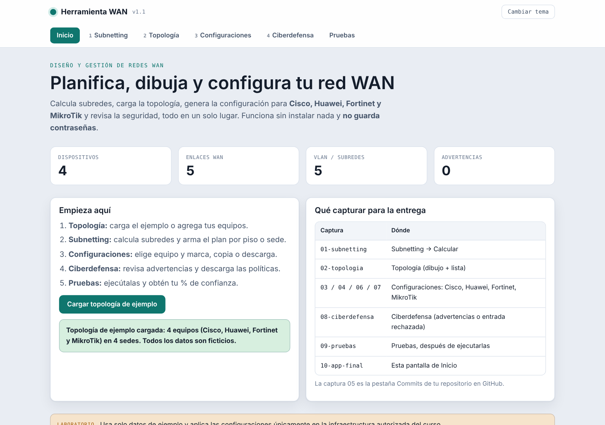

# Herramienta de Redes WAN — Julieth Borbón  

**Materia:** Interconexión de Redes WAN
**Repositorio (público):** https://github.com/juliethborbon/redes-wan-Borbon

## Qué hace esta herramienta
Herramienta web, construida con ayuda de IA, que calcula subredes, carga la topología de una red WAN de varias sedes y genera la configuración de los equipos para **Cisco, Huawei, Fortinet y MikroTik**. Integra ciberdefensa: no guarda contraseñas, valida todo lo que se escribe y advierte configuraciones inseguras.

## Funciones
- Subnetting / IP Planning (IPv4/IPv6, público/privado, división de redes y plan por piso con VLSM)
- Carga de la topología (dispositivos, VLAN, enlaces WAN, ISP; formulario o JSON)
- Generación de configuraciones: Cisco, Huawei, Fortinet, MikroTik
- Ciberdefensa contra IA (aplica [docs/politicas-ia.md](docs/politicas-ia.md))
- Pruebas automáticas con % de confianza

## Cómo ejecutarla
1. Descarga `herramienta-wan.html` (botón **Download raw file**).
2. Ábrelo con doble clic en Chrome o Edge. No hay que instalar nada.
3. En **Inicio**, pulsa **Cargar topología de ejemplo**.
4. Para comprobarla: pestaña **Pruebas** → **Ejecutar pruebas**.

Guía completa: [docs/manual.md](docs/manual.md)

## Pruebas y % de confianza  (Corte 3)
- Pruebas superadas: **37 de 37 = 100 %** (ver [docs/pruebas.md](docs/pruebas.md))

| Función | Pruebas |
|---|---|
| Subnetting | 14 / 14 |
| Topología | 5 / 5 |
| Configuraciones (4 marcas) | 10 / 10 |
| Ciberdefensa | 8 / 8 |

## Documentos
- [docs/informe-corte2.pdf](docs/informe-corte2.pdf) · [docs/informe-corte3.pdf](docs/informe-corte3.pdf)
- [docs/manual.md](docs/manual.md) · [docs/seguridad.md](docs/seguridad.md) · [docs/politicas-ia.md](docs/politicas-ia.md) · [docs/pruebas.md](docs/pruebas.md)
- Configuraciones de ejemplo: [configs/](configs/) · Topología y subnetting de ejemplo: [ejemplos/](ejemplos/)

## Capturas (evidencias)
`docs/capturas/` (01-subnetting.png … 10-app-final.png)

| Corte 2 | Corte 3 |
|---|---|
| [01-subnetting](docs/capturas/01-subnetting.png) | [06-config-fortinet](docs/capturas/06-config-fortinet.png) |
| [02-topologia](docs/capturas/02-topologia.png) | [07-config-mikrotik](docs/capturas/07-config-mikrotik.png) |
| [03-config-cisco](docs/capturas/03-config-cisco.png) | [08-ciberdefensa](docs/capturas/08-ciberdefensa.png) |
| [04-config-huawei](docs/capturas/04-config-huawei.png) | [09-pruebas](docs/capturas/09-pruebas.png) |
| [05-github-commits](docs/capturas/05-github-commits.png) | [10-app-final](docs/capturas/10-app-final.png) |

## Autoevaluación (marca Sí/No)
| Criterio                          | ¿Cumplido? | Evidencia            |
|-----------------------------------|------------|----------------------|
| Subnetting funciona               | Sí         | 01-subnetting.png    |
| Carga de topología                | Sí         | 02-topologia.png     |
| Config Cisco y Huawei             | Sí         | 03 / 04              |
| Config Fortinet y MikroTik (C3)   | Sí         | 06 / 07              |
| Ciberdefensa (politicas-ia.md)    | Sí         | 08-ciberdefensa.png  |
| Pruebas con % de confianza (C3)   | Sí         | docs/pruebas.md      |

## Historial de versiones
| Versión | Corte | Qué incluye |
|---|---|---|
| v1.0 | 2 | Subnetting, topología, configuraciones Cisco y Huawei, ciberdefensa básica, 32 pruebas |
| v1.1 | 3 | Fortinet y MikroTik documentados; NAT para las sedes vecinas que salen a Internet por otro router; 5 pruebas nuevas (37); resumen de pruebas por función; manual y seguridad.md |

> Solo datos de ejemplo (redes privadas y rangos de documentación). Las configuraciones se aplican únicamente en el laboratorio autorizado.
