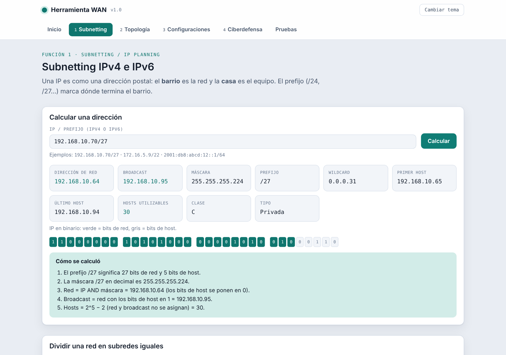
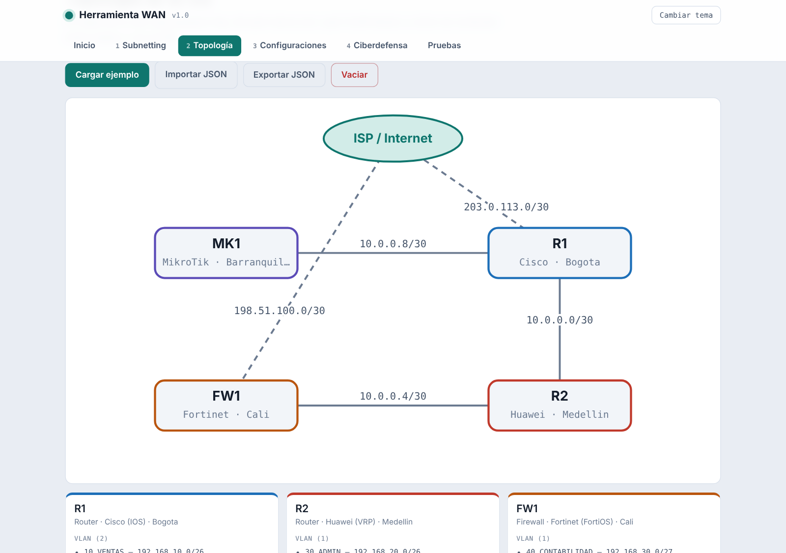
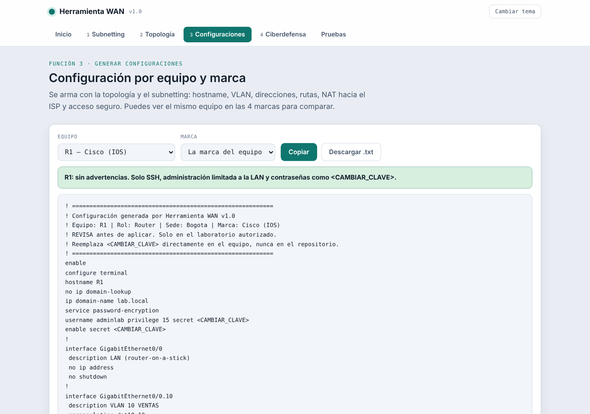
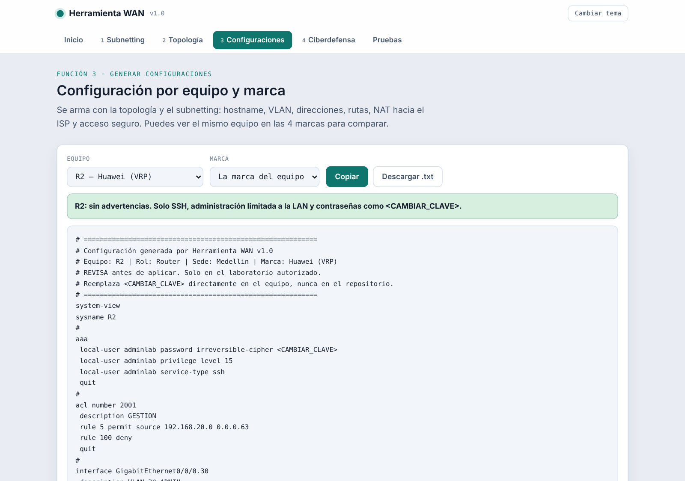

# Herramienta de diseño y gestión de redes WAN

**Curso:** Interconexión de Redes WAN · **Entrega:** Corte 2 · **Trabajo individual**
**Estudiante:** [Julieth Borbón]

Herramienta web, construida con ayuda de IA, para **calcular subredes**, **cargar la topología** de una red WAN y **generar configuraciones Cisco y Huawei**. Incluye ciberdefensa: no guarda contraseñas, valida todo lo que se escribe y advierte configuraciones inseguras.

> Todos los datos son de ejemplo (redes privadas y rangos de documentación). Las configuraciones se aplican solo en el laboratorio autorizado del curso.

---

## Cómo abrirla

1. Descarga `herramienta-wan.html` (botón **Download raw file**).
2. Dale doble clic: se abre en Chrome o Edge. No hay que instalar nada.
3. En **Inicio**, pulsa **Cargar topología de ejemplo**.

## Funciones del Corte 2

### 1. Subnetting / IP planning
Calcula red, broadcast, máscara, rango utilizable y hosts (IPv4 e IPv6), divide redes y arma el plan por piso con VLSM. Rechaza IPs inválidas como `999.1.1.1`.

| Prueba | Resultado |
|---|---|
| 192.168.10.70/27 | Red 192.168.10.64 · Broadcast 192.168.10.95 · 30 hosts |

Detalle: [`ejemplos/plan-subnetting.md`](ejemplos/plan-subnetting.md)



### 2. Carga de la topología
Formulario o archivo JSON con equipos, marca, VLAN y enlaces WAN. La herramienta dibuja la red y rechaza datos mal formados o con código.

Archivo de ejemplo: [`ejemplos/topologia-ejemplo.json`](ejemplos/topologia-ejemplo.json) · Detalle: [`ejemplos/topologia.md`](ejemplos/topologia.md)



### 3. Configuraciones Cisco + Huawei
A partir de la topología y el subnetting genera hostname, VLAN, IPs, rutas estáticas, ruta por defecto y acceso solo por SSH. Las contraseñas aparecen como `<CAMBIAR_CLAVE>`.

Archivos: [`configs/`](configs/)




### 4. Ciberdefensa contra IA
- Sin contraseñas ni tokens en el repositorio: `.env` está en `.gitignore` y solo se sube `.env.example`.
- Validación de todo lo que se escribe o importa; lo que parece código se rechaza.
- Advertencias de configuraciones inseguras (Telnet, claves por defecto, administración desde la WAN).
- Políticas: [`docs/politicas-ia.md`](docs/politicas-ia.md) · Pruebas: [`docs/pruebas.md`](docs/pruebas.md)

## Estructura del repositorio

```
README.md
.gitignore
.env.example
herramienta-wan.html
ejemplos/   plan-subnetting.md · topologia-ejemplo.json · topologia.md
configs/    R1-cisco.txt · R2-huawei.txt · R1-huawei.txt
docs/       informe-corte2.pdf · politicas-ia.md · pruebas.md
docs/capturas/  01-subnetting · 02-topologia · 03-config-cisco · 04-config-huawei · 05-github-commits
```

## Autoevaluación (rúbrica Corte 2)

| Criterio | Peso | Evidencia |
|---|---|---|
| Subnetting funcional | 20 % | Pestaña 1, `ejemplos/plan-subnetting.md`, captura 01 |
| Carga de topología | 15 % | Pestaña 2, `ejemplos/topologia-ejemplo.json`, captura 02 |
| Configuraciones Cisco + Huawei | 25 % | `configs/`, capturas 03 y 04 |
| Ciberdefensa aplicada | 10 % | `.gitignore`, `.env.example`, `docs/politicas-ia.md` |
| Documento | 10 % | `docs/informe-corte2.pdf` |
| Repositorio y versiones | 20 % | Rama `feature/herramienta-corte2`, Pull Request, captura 05 |

## Historial de versiones

| Versión | Qué incluye |
|---|---|
| v1.0 | Subnetting, topología, configuraciones Cisco/Huawei (y Fortinet/MikroTik para el Corte 3), ciberdefensa y 32 pruebas automáticas |
